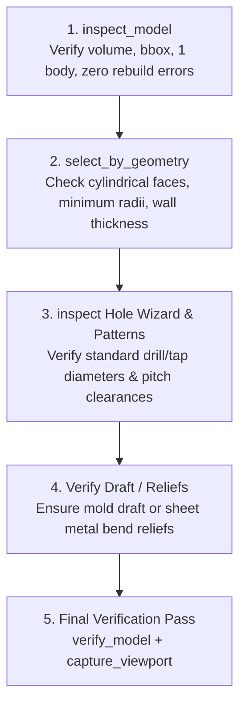

# Design for Manufacturing (DFM) & Additive (DfAM) in SolidWorks

## When this skill applies
Use this skill whenever designing, modifying, or reviewing SolidWorks CAD parts to ensure they can be economically and reliably manufactured using standard industrial processes:
- **CNC Milling & Turning**: Tool clearances, internal pocket corner radii, aspect ratios, standard thread profiles.
- **Sheet Metal Bending**: Minimum bend radii, hole-to-bend keepout zones, bend relief cutouts.
- **Additive Manufacturing (3D Printing / DfAM)**: Self-supporting overhang limits ($45^\circ$ rule), minimum wall thicknesses, bridging spans, and horizontal hole diameter compensation.
- **Plastic Injection Molding**: Nominal wall thickness uniformity, draft angles for mold release, core-out strategies, and rib-to-wall thickness ratios to prevent sink marks.

---

## 1. CNC Milling & Turning Rules

### A. Internal Pocket Radii (The Rotary Tool Constraint)
- **Constraint**: Rotary endmills cannot cut sharp $90^\circ$ inside vertical corners.
- **Rule**: Internal corner radius must be $\ge R_{\text{tool}} + 0.5\text{ mm}$.
  - For standard $\varnothing 6\text{ mm}$ endmill: internal fillet $R \ge 3.5\text{ mm}$.
  - For standard $\varnothing 10\text{ mm}$ endmill: internal fillet $R \ge 5.5\text{ mm}$.
  - Adding $+0.5\text{ mm}$ allows the tool to sweep through the corner without decelerating to zero, reducing chatter and tool breakage.
- **Alternative**: If sharp mating parts must sit in a pocket, model **dogbone** or **T-bone corner reliefs** at inside vertices.

### B. Cavity Depth-to-Width Ratio (Tool Deflection & Chatter)
- **Standard Tooling**: Maximum cavity depth $\le 4 \times$ pocket width.
- **Extended Reach Tooling**: Maximum cavity depth $\le 8 \times$ pocket width (increases machining cost and surface roughness).
- **Deep Pockets**: If depth $> 4 \times$ width, incorporate draft ($1^\circ - 2^\circ$) or widen the cavity opening.

### C. Minimum Wall Thickness
- **Metals (Aluminum 6061, Steels, Brass)**: Minimum wall thickness $t \ge 0.8\text{ mm}$ ($1.5\text{ mm}$ recommended for tall walls).
- **Plastics (Delrin / POM, ABS, Nylon)**: Minimum wall thickness $t \ge 1.5\text{ mm}$ ($2.0\text{ mm}$ recommended to resist cutting forces).

### D. Turned Parts (Lathe Turning)
- Maintain centered symmetry where possible.
- Provide $1 \times 45^\circ$ lead-in chamfers on shaft ends for bearing / bushing insertion.
- Add thread relief undercuts (groove width $\ge 1.5 \times$ thread pitch) adjacent to shoulders before external threads.

---

## 2. Sheet Metal & Press Brake Bending Rules

### A. Minimum Bend Radius ($R_{\text{min}}$)
- Soft Aluminum (5052-H32, 3003-H14) & Low-Carbon Steel: $R \ge 1.0 \times T$ (where $T$ is sheet thickness).
- Stainless Steel (304, 316) & Hard Alloys: $R \ge 2.0 \times T$.
- Sharp inside bends ($R = 0$) create severe stress concentrations and micro-cracking along the bend line.

### B. Hole-to-Bend Keepout Distance
- Any hole or cutout too close to a bend line will deform into an ellipse during press brake forming.
- **Keepout Rule**: Minimum distance from hole edge to inside bend tangent line:
  $$D_{\text{hole}} \ge 2.5 \times T + R$$

### C. Bend Relief Notches
- Bends that terminate into adjacent solid material tear unless relieved.
- **Relief Rule**: Cut rectangular or teardrop relief notches at both ends of every flange bend:
  - Relief notch width $\ge T$ (or $\ge 1.5\text{ mm}$).
  - Relief notch depth $\ge R + T$.

### D. Minimum Flange Length
- Short flanges slip off the press brake lower V-die during bending.
- **Minimum Flange Rule**: Total outer flange height $L_{\text{flange}} \ge 4.0 \times T$.

---

## 3. Additive Manufacturing (DfAM - 3D Printing)

### A. The $45^\circ$ Self-Supporting Rule
- Faces oriented downward at an angle $\theta > 45^\circ$ from the build vertical axis require support material, increasing print time, post-processing labor, and surface roughness.
- **Rule**: Self-support chamfers or angles must be $\le 45^\circ$ from vertical ($45^\circ$ from horizontal build plane).

### B. Minimum Wall Thickness by Process
| 3D Printing Process | Minimum Wall ($t_{\text{min}}$) | Recommended Wall ($t_{\text{rec}}$) | Minimum Feature Size |
|---|---|---|---|
| **FDM (FFF - PLA, PETG, ABS)** | $1.2\text{ mm}$ (3 perimeters) | $2.0\text{ mm}$ | $1.0\text{ mm}$ |
| **SLS (Nylon PA11 / PA12)** | $0.7\text{ mm}$ | $1.5\text{ mm}$ | $0.5\text{ mm}$ |
| **SLA / DLP (Resin)** | $0.6\text{ mm}$ | $1.2\text{ mm}$ | $0.3\text{ mm}$ |
| **SLM / DMLS (Metal PBF)** | $0.5\text{ mm}$ | $1.0\text{ mm}$ | $0.4\text{ mm}$ |

### C. Horizontal Hole Compensation
- FDM printers consistently shrink horizontal through-holes due to filament polymer tension and slicing polygons.
- **Rule**: Holes with $\varnothing < 5\text{ mm}$ should be modeled $+0.2\text{ mm}$ to $+0.3\text{ mm}$ oversized, or designed for secondary post-reaming/drilling.
- For unsupported circular holes $\varnothing > 15\text{ mm}$ printing horizontally without support, use a **teardrop profile** (top apex angled at $45^\circ$).

### D. Unsupported Bridging Limits
- Flat horizontal spans (bridges) without supports should not exceed $10\text{ mm}$ in FDM. Spans $> 10\text{ mm}$ sag or string.

---

## 4. Plastic Injection Molding Rules

### A. Uniform Nominal Wall Thickness
- Non-uniform walls cool at different rates, producing severe internal stresses, sink marks, and warpage.
- **Rule**: Maintain nominal wall thickness within $\pm 25\%$ across the entire part.
- Core out thick sections using `cut_extrude` or `create_shell` rather than modeling solid masses.

### B. Draft Angles for Mold Release
- All vertical surfaces perpendicular to the mold parting plane require draft to allow the part to eject without scuffing or sticking.
- **Standard Walls**: Minimum $1.0^\circ$ draft ($1.5^\circ - 2.0^\circ$ preferred).
- **Deep Cavities (> 50mm)**: $2.0^\circ - 3.0^\circ$ draft.
- **Ribs**: $0.5^\circ - 1.0^\circ$ draft per side.
- **Textured Surfaces (SPI-C1, Mold-Tech)**: Add $+1.0^\circ$ draft for every $0.025\text{ mm}$ of texture depth.

### C. Rib Design & Sink Prevention
- Reinforcement ribs stiffen the part without increasing overall wall thickness.
- **Rib-to-Wall Ratio**: Rib thickness at base must be $50\%$ to $60\%$ of nominal wall thickness ($T_{\text{rib}} \le 0.6 \times T_{\text{wall}}$).
- **Rib Height**: Maximum $3 \times T_{\text{wall}}$.
- **Base Radii**: Fillet rib base with $R = 0.25 \times T_{\text{wall}}$ to reduce notch stress concentrations while preventing sink.

---

## 5. DFM Audit Checklist & Inspection Recipes

Before finalizing or releasing any SolidWorks model, execute this DFM inspection checklist:



### DFM Verification Script Example:
```json
// 1. Check Body Count and Bounding Box Integrity
inspect_model {}

// 2. Verify Internal Radii on Vertical Pockets (e.g. radius >= 3.5mm)
select_by_geometry {
  "target_type": "face",
  "surface_type": "cylinder",
  "radius": 3.5,
  "radius_tolerance": 0.5
}

// 3. Confirm Model has Zero Feature Rebuild Errors
inspect_rebuild_errors {}

// 4. Assert Final Model Dimensions within Manufacturing Envelope
verify_model {
  "expected_dx": 120.0,
  "expected_dy": 80.0,
  "expected_dz": 35.0,
  "expected_bodies": 1,
  "tolerance_mm": 0.5
}
```
